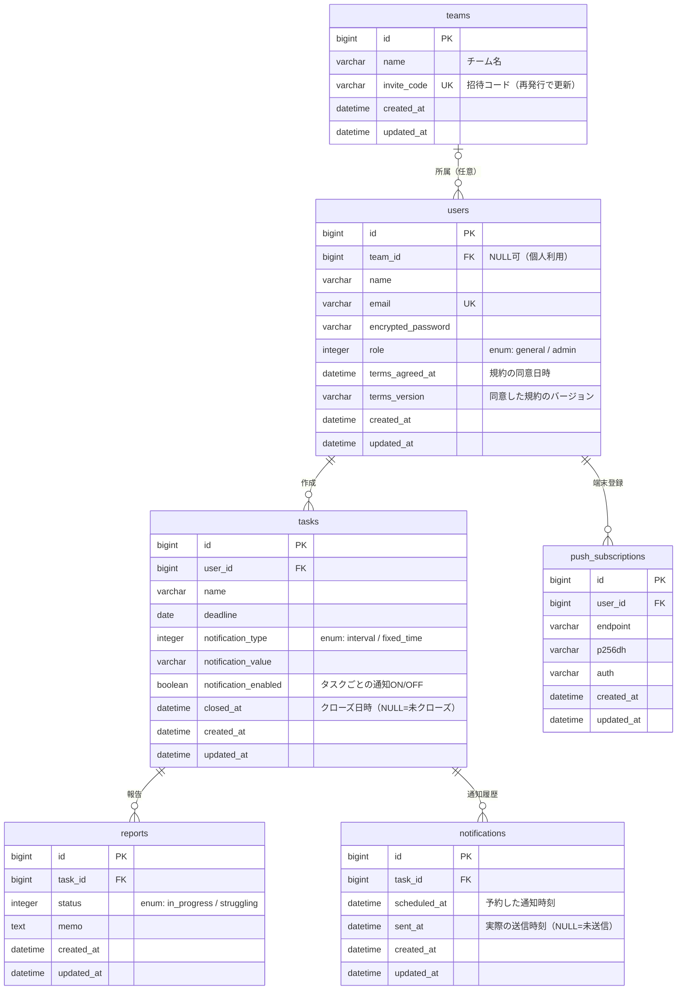

# ER図（本リリース版）

## 設計メモ
- Deviseが自動生成する列（`reset_password_token`、`reset_password_sent_at`、`remember_created_at`など）は省略している。
- `users.role`が`admin`のユーザーは、同じ`team_id`につき1人までとする（アプリ側の検証と、部分ユニークインデックスで担保する）。
- チームから外す操作は`users.team_id`をNULLにするだけで、本人のタスク・報告は残る。
- 奮闘中の継続日数は列を持たず、`reports`から集計する。
